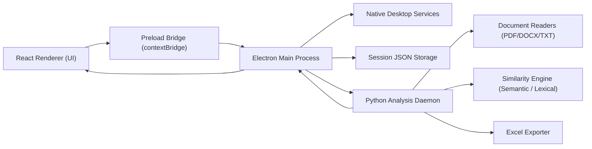

# ASDS Desktop Architecture Report

## 1. Executive Summary

ASDS Desktop is a local, packaged desktop application for document similarity analysis. The system is not built as a browser-to-server web application. Instead, it follows a layered desktop architecture composed of:

- A React-based renderer for the user interface
- An Electron main process for native desktop orchestration
- A local Python analysis engine for text extraction, similarity scoring, and report export

The application runs entirely on the user's machine. Document analysis is performed by a spawned Python daemon that communicates with Electron through JSON messages over standard input and output streams. Persistent application data is stored as JSON files in the Electron user data directory rather than in a relational or NoSQL database.

## 2. Scope and Method

This report is based on direct inspection of the authored project files in:

- `src/`
- `electron/`
- `python_bridge/`
- `similarityscope/core/`
- `package.json`
- `vite.config.js`
- `index.html`

Generated and vendor-managed artifacts such as `node_modules/`, `dist/`, and `dist-electron/` were not treated as primary sources for architecture decisions, except where build output confirmed packaging behavior.

## 3. Architectural Classification

### 3.1 Primary Architecture Style

The application is best classified as a:

- Layered desktop monolith

### 3.2 Deployment Model

The deployment model is:

- Single-machine local desktop deployment

### 3.3 Runtime Topology

The runtime is split into three cooperating parts:

1. Electron renderer process
2. Electron main process
3. Python child process

This is not a distributed system and does not expose a remote API for external consumers.

## 4. High-Level System Overview

## 5. Major Components

### 5.1 Renderer Layer

The renderer is a React application loaded into an Electron window. It is responsible for:

- Visual presentation
- Theme selection
- Local page navigation
- File selection workflow
- Analysis initiation and cancellation
- Display of similarity results and flagged groups

Key implementation characteristics:

- React 18 with `ReactDOM.createRoot`
- No router library such as `react-router`
- No global state library such as Redux or Zustand
- State handled with React hooks and a small in-memory cache
- Styling through global CSS variables and inline style objects

Primary files:

- `src/main.jsx`
- `src/App.jsx`
- `src/pages/LandingPage.jsx`
- `src/pages/ClassesPage.jsx`
- `src/pages/AnalysisPage.jsx`
- `src/components/ResultsPanel.jsx`
- `src/components/TitleBar.jsx`
- `src/index.css`

### 5.2 Desktop Orchestration Layer

The Electron main process acts as the desktop backend. It is responsible for:

- Creating and managing the application window
- Exposing native capabilities through IPC
- Opening file selection and save dialogs
- Persisting class/session data
- Starting and stopping the Python engine
- Streaming progress updates to the renderer
- Managing first-time Python environment setup in packaged mode

Primary files:

- `electron/main.js`
- `electron/preload.js`
- `electron/setupManager.js`

### 5.3 Analysis Engine Layer

The Python side performs the domain-specific work of the product. Its responsibilities include:

- Reading PDF, DOCX, and TXT files
- Normalizing and preprocessing document text
- Running semantic similarity analysis
- Running lexical similarity analysis
- Exporting analysis results to Excel

Primary files:

- `python_bridge/run_analysis.py`
- `python_bridge/tech_stopwords.py`
- `similarityscope/core/file_reader.py`
- `similarityscope/core/exporter.py`

## 6. Frontend Technology Stack

The frontend stack used by the application is:

| Area | Technology | Evidence |
|---|---|---|
| UI library | React 18 | `package.json`, `src/main.jsx` |
| DOM rendering | ReactDOM | `src/main.jsx` |
| Bundler/dev server | Vite 5 | `package.json`, `vite.config.js` |
| Vite React integration | `@vitejs/plugin-react` | `package.json`, `vite.config.js` |
| Styling | Plain CSS and inline style objects | `src/index.css`, page/component files |
| Fonts | Inter, JetBrains Mono via Google Fonts | `index.html` |
| Navigation | Local component-state page switching | `src/App.jsx` |
| State management | React hooks and in-memory `Map` cache | `src/App.jsx`, `src/pages/AnalysisPage.jsx` |

Not present in the authored code:

- `react-router`
- Redux
- Zustand
- Tailwind CSS
- Material UI
- Chakra UI
- Axios

## 7. Backend and Analysis Technology Stack

The application does not use a remote backend service. Its backend responsibilities are shared between Electron main and a local Python engine.

### 7.1 Electron/Desktop Backend

| Area | Technology | Evidence |
|---|---|---|
| Desktop runtime | Electron 33 | `package.json` |
| IPC bridge | `contextBridge`, `ipcRenderer`, `ipcMain` | `electron/preload.js`, `electron/main.js` |
| Native dialogs | Electron `dialog` | `electron/main.js` |
| Local filesystem persistence | Node `fs` | `electron/main.js` |
| Child process management | Node `child_process.spawn` | `electron/main.js` |
| Packaging | `electron-builder` | `package.json`, `dist-electron/builder-effective-config.yaml` |

### 7.2 Python Analysis Backend

| Area | Technology | Purpose |
|---|---|---|
| Embedded runtime | Python 3.10.11 embeddable package | Packaged local execution |
| ML runtime | PyTorch | Model execution |
| Semantic analysis | `sentence-transformers` | Embeddings and reranking |
| Lexical analysis | `scikit-learn` | TF-IDF similarity |
| PDF extraction | PyMuPDF (`fitz`) | Read PDF text |
| DOCX extraction | `python-docx` | Read Word text |
| Excel export | `openpyxl` | Generate `.xlsx` reports |

### 7.3 Models and Analysis Methods

Semantic mode uses:

- `all-mpnet-base-v2` bi-encoder
- `cross-encoder/stsb-roberta-base` for reranking borderline pairs

Lexical mode uses:

- TF-IDF vectorization with unigrams and bigrams
- cosine similarity from scikit-learn

## 8. Data Flow

### 8.1 End-to-End Analysis Flow

1. The user selects or drags files into the renderer.
2. React invokes `window.electronAPI.runAnalysis(...)`.
3. The preload script forwards the request through Electron IPC.
4. Electron main sends a JSON command to the Python daemon over stdin.
5. Python reads the files, computes similarities, and emits progress and results as JSON lines over stdout.
6. Electron main parses those messages and forwards progress events to the renderer.
7. The renderer updates the UI and stores analysis state in memory.
8. Electron main persists session updates as JSON files.

### 8.2 Export Flow

1. The user requests export from the analysis page.
2. Electron opens a native save dialog.
3. Electron sends an export command to the Python daemon.
4. Python builds an Excel workbook and writes it to the selected path.
5. Electron opens the destination folder on success.

## 9. Storage and Persistence

### 9.1 Session Persistence

Class/session information is stored as JSON files in a `sessions` folder under Electron's `userData` path. Each session contains:

- Class metadata
- Selected file paths
- Analysis mode
- Thresholds
- Previous results
- Filenames
- Last analyzed timestamp

This means the application uses:

- File-based persistence

It does not use:

- SQLite
- PostgreSQL
- MySQL
- MongoDB
- Redis

### 9.2 Client-Side State

The renderer stores:

- Theme preference in `localStorage`
- Temporary analysis state in React state
- Per-class UI cache in an in-memory `Map`

## 10. Build, Packaging, and Distribution

The project uses:

- Vite for frontend bundling
- Electron for desktop runtime
- `electron-builder` for packaging
- NSIS for Windows installer generation

The packaged desktop app includes:

- Built frontend assets from `dist/`
- Electron main and preload files
- Python bridge scripts as extra resources
- Core Python helper modules as extra resources

## 11. Security and Boundary Design

The project shows several positive desktop security choices:

- `contextIsolation: true`
- `nodeIntegration: false`
- Renderer access to native capabilities is limited to methods explicitly exposed through `contextBridge`

There is also a CSP declared in `index.html`.

Architectural caveats:

- `sandbox` is explicitly disabled in the `BrowserWindow` configuration
- The renderer depends on externally hosted Google Fonts, so the UI is not fully self-contained offline from an asset-loading perspective

## 12. Functional Architecture Observations

### 12.1 UI Structure

The renderer behaves like a simple single-page application but uses manual page switching rather than route-based navigation. The main views are:

- Landing/setup page
- Class/session page
- Analysis page

### 12.2 Result Presentation

The results layer does more than display flat pair lists. It:

- Applies threshold-aware display logic
- Groups flagged pairs transitively using a union-find structure
- Separates flagged groups from all pairs
- Supports semantic and lexical result sets independently

### 12.3 First-Time Setup Pattern

In packaged mode, the desktop app can bootstrap its own local AI environment by:

- Downloading embeddable Python
- Enabling `site` packages
- Installing `pip`
- Installing CPU PyTorch and NLP/document dependencies

This is a notable architectural decision because the product is designed to self-provision its analysis runtime on end-user machines.

## 13. Identified Gaps and Minor Issues

The following small issues were observed during inspection:

- `electron/preload.js` exposes `getPythonStatus`, but no matching `ipcMain.handle('python:status')` was found in `electron/main.js`
- The codebase contains some character-encoding artifacts in comments and UI strings, which suggests inconsistent file encoding at some point in the project lifecycle

These do not change the overall architecture, but they are worth noting for maintainability.

## 14. Final Assessment

ASDS Desktop is a local AI-assisted document analysis desktop application built with a clear separation between presentation, desktop orchestration, and analysis execution. Its architecture is well described as:

- React renderer on Electron
- Electron main process as local application backend
- Python child process as ML and document-processing engine

From a technology-stack perspective:

- Frontend: React, ReactDOM, Vite, CSS
- Desktop backend: Electron, Node.js IPC, filesystem, dialogs, process spawning
- Analysis backend: Python, sentence-transformers, PyTorch, scikit-learn, PyMuPDF, python-docx, openpyxl

The application is best understood as a self-contained desktop system rather than a web application with a server backend.
