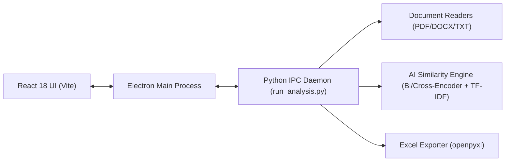

# ASDS Desktop — Academic Similarity Detection System

[](https://www.electronjs.org/)
[](https://react.dev/)
[](https://vitejs.dev/)
[](https://www.python.org/)
[](https://pytorch.org/)

**ASDS Desktop** is a modern, high-performance, and privacy-first desktop application designed for pairwise document similarity analysis. It detects conceptual and verbatim overlap across academic project abstracts, seminar reports, and student assignments.

The application runs **100% locally on the user's machine** — no documents, abstracts, or extracted text are uploaded to any cloud service.

---

## Key Features

- **Dual Analysis Engines**:
  - **Semantic Mode (Research Abstracts & Projects)**: 
    - **Stage 1 (Bi-Encoder)**: Fast dense vector embeddings via `all-mpnet-base-v2` with cosine similarity.
    - **Stage 2 (Cross-Encoder)**: Reranks borderline pairs (between threshold and 80%) using `cross-encoder/stsb-roberta-base` for human-level precision.
    - **Domain Stopword Filtering**: Strips common academic boilerplate (e.g., "methodology", "proposed system", "dataset") to focus exclusively on core intellectual overlap.
  - **Lexical Mode (Assignments & Direct Text)**:
    - Unigram and bigram TF-IDF vectorization with cosine similarity via `scikit-learn`.
- **Multi-Format Document Parsing**:
  - Direct text extraction from `.pdf` (via PyMuPDF / `fitz`), `.docx` (via `python-docx` including tables, headers, and footers), and `.txt`.
- **Interactive Results & Matrix**:
  - Visual similarity matrix, flagged pairs ranking, dynamic threshold filtering, and document preview.
- **Session & Class Management**:
  - Organize documents by classes and persist session data locally in JSON format.
- **Excel Report Export**:
  - Generates polished, color-coded `.xlsx` reports with rank, scores, and status flags using `openpyxl`.

---

## Architecture Overview



- **Frontend**: React 18, Vite 5, plain CSS with modern dark UI styling.
- **Desktop Shell**: Electron 33 orchestrating native dialogs, IPC, and child process lifecycle.
- **Analysis Core**: Long-running Python daemon communicating over standard I/O streams using JSON lines.

---

## Development Environment Setup

Follow these steps to set up the development environment from scratch.

### Prerequisites

Ensure you have the following installed on your system:

1. **Node.js**: `v18.x` or `v20.x` LTS ([Download Node.js](https://nodejs.org/))
2. **Python**: `3.10` or higher ([Download Python](https://www.python.org/downloads/))
   - *Important (Windows)*: Check the box **"Add Python to PATH"** during installation.
3. **Git**: ([Download Git](https://git-scm.com/))

---

### Step 1: Clone the Repository

```bash
git clone https://github.com/<your-username>/asds-desktop.git
cd asds-desktop/asds-electron
```
*(If your repository root is already `asds-electron`, run the commands directly in that folder).*

---

### Step 2: Set Up Python Virtual Environment

It is recommended to run the Python bridge within a dedicated virtual environment:

#### Windows:
```powershell
# Create virtual environment
python -m venv venv

# Activate virtual environment
.\venv\Scripts\Activate.ps1
# If PowerShell script execution is restricted:
# Set-ExecutionPolicy -Scope Process -ExecutionPolicy Bypass
```

#### macOS / Linux:
```bash
python3 -m venv venv
source venv/bin/activate
```

---

### Step 3: Install Python Dependencies (`requirements.txt`)

Install the required machine learning, document reading, and export packages:

#### Option A: Standard Installation (Recommended for CUDA / GPU or general setups)
```bash
pip install --upgrade pip
pip install -r requirements.txt
```

#### Option B: Fast CPU-Only Installation (Saves ~2 GB of download if GPU is not needed)
```bash
pip install --upgrade pip
pip install torch torchvision torchaudio --extra-index-url https://download.pytorch.org/whl/cpu
pip install -r requirements.txt
```

#### Python Dependencies Breakdown

| Package | Purpose in ASDS |
| :--- | :--- |
| `sentence-transformers` | Generates semantic sentence embeddings and cross-encoder reranking |
| `torch` | Underlying deep learning execution runtime for transformer models |
| `scikit-learn` | TF-IDF vectorization and cosine similarity for lexical mode |
| `PyMuPDF` (`fitz`) | Fast, accurate text extraction from `.pdf` documents |
| `python-docx` | Extracts text, tables, headers, and footers from Word (`.docx`) files |
| `openpyxl` | Formats and outputs styled Excel `.xlsx` reports |

---

### Step 4: Install Node.js Dependencies

In the `asds-electron` directory, install frontend and Electron dependencies:

```bash
npm install
```

---

### Step 5: Start the Development Server

Run the development environment:

```bash
npm run dev
```

This concurrently launches:
1. **Vite Dev Server** on `http://localhost:5173` with Hot Module Replacement (HMR).
2. **Electron Window**, which spawns the background Python daemon (`python_bridge/run_analysis.py`).

---

## Available Scripts

| Command | Action |
| :--- | :--- |
| `npm run dev` | Starts Vite dev server and launches Electron with live reload |
| `npm run dev:vite` | Runs only the Vite web development server |
| `npm run dev:electron`| Waits for Vite on port 5173 and starts the Electron process |
| `npm run build` | Builds the React production bundle and packages the desktop installer |
| `npm run preview` | Previews the Vite production build locally |

---

## Packaging & Production Build

To create an installer for Windows:

```bash
npm run build
```

This command:
1. Compiles the React UI with Vite into `dist/`.
2. Packages the Electron application using `electron-builder`.
3. Generates the standalone NSIS installer in `dist-electron/` (e.g., `ASDS Desktop Setup 1.0.0.exe`).

> **Note on Packaged Runtime**: In production mode, the application uses an automated setup manager (`electron/setupManager.js`) that provisions an isolated embedded Python engine with all required dependencies in `%LOCALAPPDATA%`, ensuring end users do not need Python pre-installed.

---

## Project Structure

```text
asds-electron/
├── build/                      # Build assets (e.g. icon.ico)
├── electron/                   # Electron main process & IPC orchestration
│   ├── main.js                 # App lifecycle, IPC, and Python process management
│   ├── preload.js              # Secure contextBridge API for the renderer
│   └── setupManager.js         # Embedded Python runtime downloader for end users
├── python_bridge/              # Python analysis engine & IPC daemon
│   ├── run_analysis.py         # Main analysis daemon (stdin/stdout JSON protocol)
│   └── tech_stopwords.py       # Domain-specific stopwords for academic text
├── similarityscope/            # Core analysis utilities
│   └── core/
│       ├── exporter.py         # Excel (.xlsx) report generation via openpyxl
│       └── file_reader.py      # Multi-format document parser (PDF, DOCX, TXT)
├── src/                        # React frontend (Vite)
│   ├── components/             # UI components (ResultsPanel, TitleBar, etc.)
│   ├── pages/                  # Views (LandingPage, ClassesPage, AnalysisPage)
│   ├── App.jsx                 # Application state and routing
│   ├── index.css               # Global styles and design tokens
│   └── main.jsx                # React DOM entry point
├── index.html                  # HTML template
├── package.json                # Node.js project metadata & dependencies
├── requirements.txt            # Python dependencies
├── vite.config.js              # Vite configuration
└── .gitignore                  # Git ignore rules for build artifacts & caches
```

---

## Troubleshooting

- **`Python executable not found` in development**:
  - Ensure `python` (Windows) or `python3` (macOS/Linux) is added to your system `PATH`.
  - If using a virtual environment, activate it before executing `npm run dev`.
- **First-time Semantic Analysis takes 10–20 seconds**:
  - The first semantic run downloads and caches Hugging Face transformer weights (`all-mpnet-base-v2` ~420MB and `cross-encoder/stsb-roberta-base` ~500MB). Subsequent runs use the local cache in `%USERPROFILE%/.cache/huggingface` and load instantly.
- **File parsing returns 0 words**:
  - Scanned image PDFs without an OCR text layer cannot be read by text extractors. Ensure input files contain extractable text.

---

## License

This project is licensed under the MIT License - see the LICENSE file for details.

